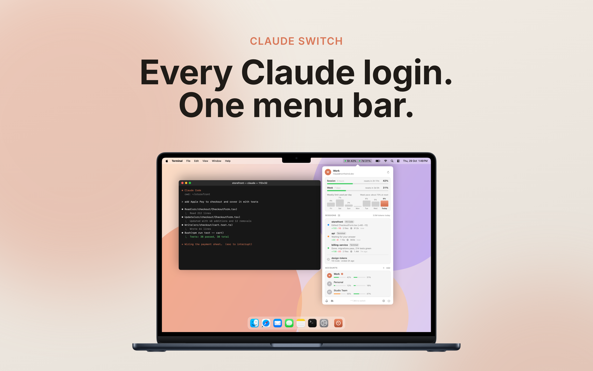
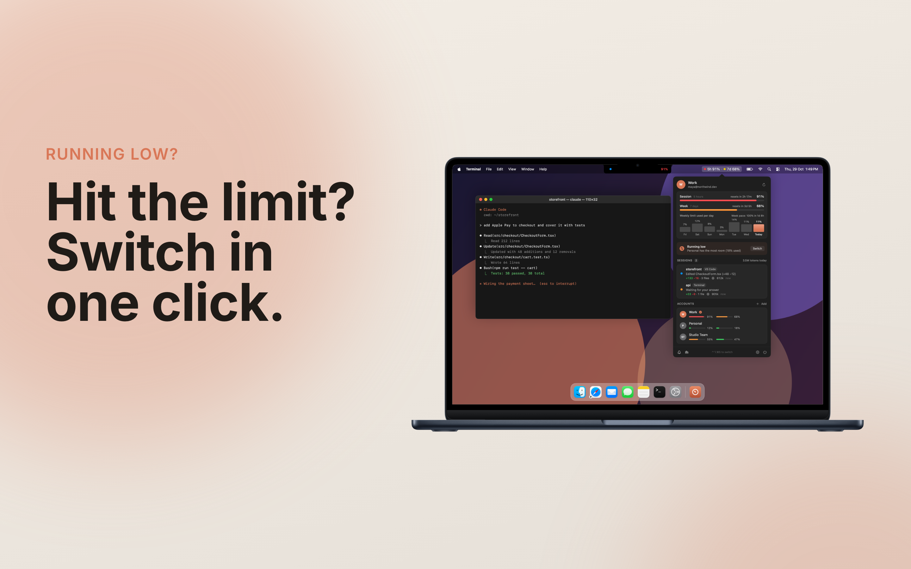
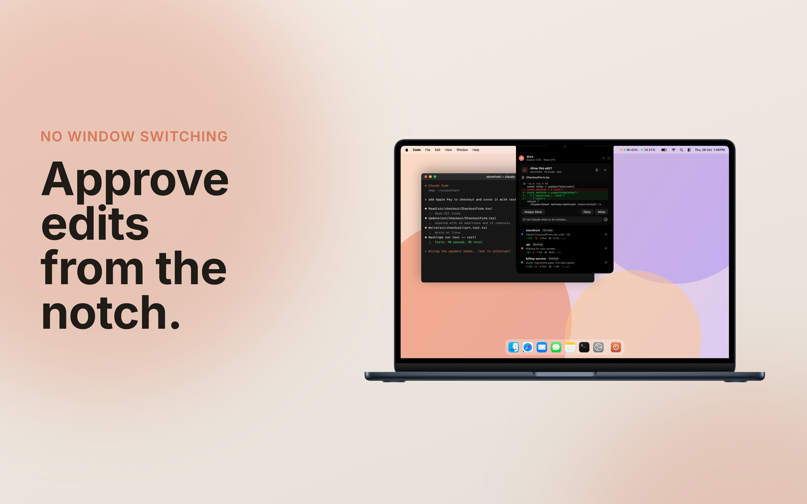
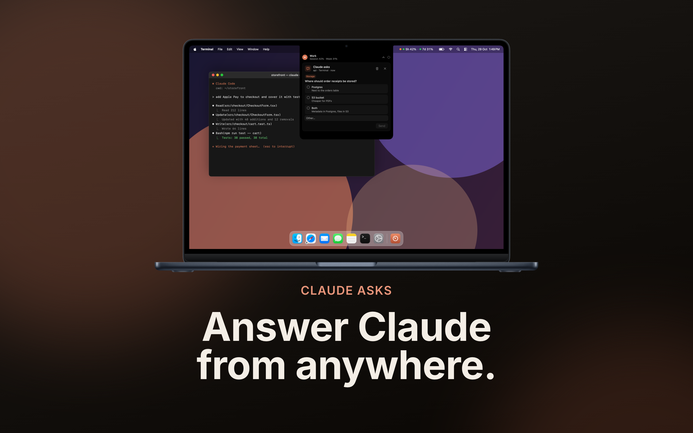
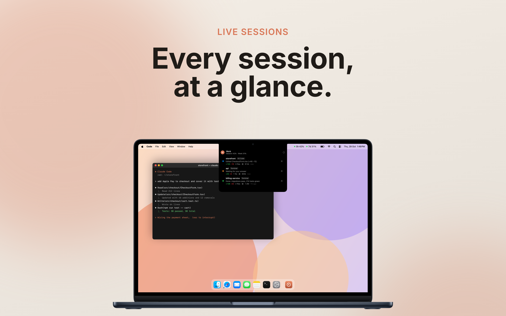
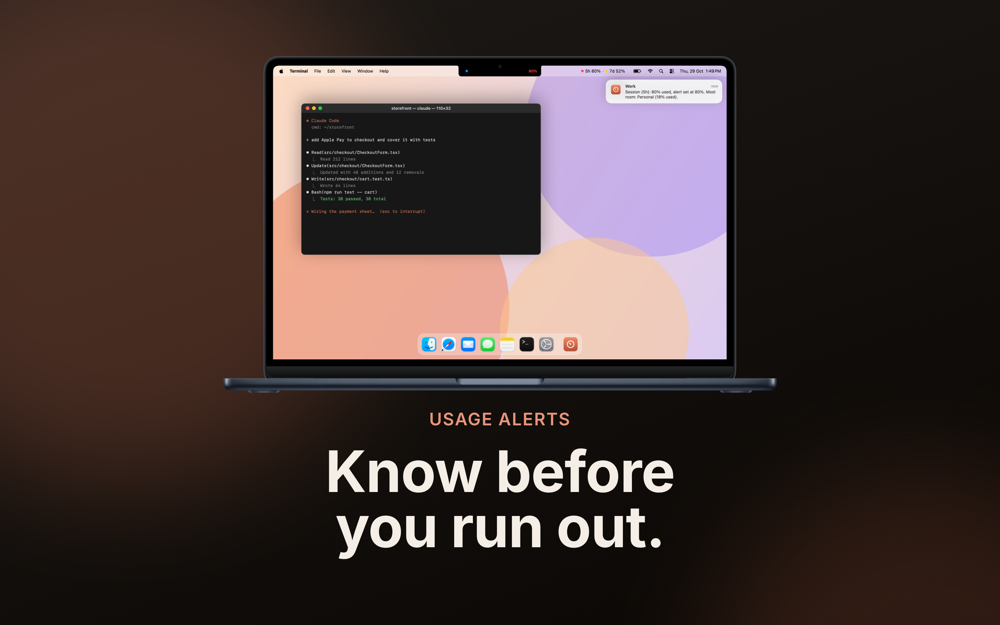

# Claude Switch

**Every Claude login. One menu bar.**

Claude Switch is a macOS menu bar app for people who use Claude Code with more than one account. It shows the
session and weekly usage for every saved account, switches the Claude Code login for the terminal and VS Code in one
click, and lets you answer Claude's permission prompts and questions from the notch without leaving what you are doing.



## Features

### Usage for every account

The menu bar shows the current account's 5-hour session and 7-day usage (`5h 42% · 7d 31%`). Open it to see when each
limit resets, the weekly limit used per day, the live Claude sessions and the usage of every saved account.

### Switch in one click

When the current account runs low, the panel points to the account with the most room left. Click **Switch**, pick
any account in the list, or press **Control-Option-Command-S** to move to the next one.



### Approve edits from the notch

Permission prompts open in an island under the notch. It shows the diff, with **Allow**, **Always Allow** and **Deny**.
You can also tell Claude what to do instead, in words. An island that opened for a request folds away after a set time,
and a countdown bar shows the time left. On a display without a notch, the island sits at the top centre of the screen.



### Answer Claude from anywhere

When Claude asks a question, its options show in the same island. Pick one, or type your own answer under **Other**.



### Every session at a glance

Each running Claude session shows its project, where it runs (Terminal or VS Code) and what it is doing. Waiting
sessions, finished work, lines changed and tokens used all show in the list. Click a session to go to its window.



### Usage alerts

Set a threshold, and Claude Switch notifies you before you run out. The notification names the account with the most
room left. It can also tell you when a limit resets.



## Requirements

- macOS 13 or later, Apple silicon or Intel
- [Claude Code](https://docs.claude.com/en/docs/claude-code), signed in at least once
- `jq` (`brew install jq`)
- Xcode Command Line Tools to build from source (`xcode-select --install`)

## Install

```bash
git clone https://github.com/saranshbalyan-1234/claude-switch.git
cd claude-switch
./run.sh
```

`./run.sh` (the same as `./run.sh setup`) does three things:

1. It installs the `claude-switch` command in `~/.local/bin` and adds that folder to your `PATH` when needed.
2. It adds Claude Code hooks next to the hooks you already have. Your previous settings are kept as
   `~/.claude/settings.json.before-claude-switch`.
3. It builds `Claude Switch.app` (about 40 seconds), installs it in `~/Applications`, sets it to open at login and
   starts it.

Then save each account:

```bash
claude-switch add        # keep the current login, sign in to another account, and save that one too
```

You can also use **Add account…** in the menu bar. If you have just used `/login` in Claude, run `claude-switch save`.

After each switch, restart the Claude sessions that are open in the terminal and VS Code.

## Command line

```text
claude-switch                     switch to the next saved account (after the last comes the first)
claude-switch <email>             switch to that account
claude-switch save                save the account you are logged into now
claude-switch add [email]         sign in to another account and save it
claude-switch remove <email>      forget a saved account (not the current one)
claude-switch --quit-running      quit running Claude sessions first, then switch
claude-switch hooks [status|install|remove]
claude-switch rules [list|remove <rule>]   the always-allow rules in Claude Code's user settings
claude-switch recap [days]        what Claude did over the last days (default 7)
```

On Linux, the command line and the hooks work without the menu bar app. Notifications go through `notify-send`.

## How it works

- **Logins:** Claude Code keeps its login in the macOS Keychain item `Claude Code-credentials`. Claude Switch saves a
  copy of each account in its own Keychain items (`claude-switch`) and swaps the live item when you switch. Tokens go
  to `security` on stdin, so they never show up in `ps`. On Linux, the copies are in `~/.claude/switch-logins`, which
  only you can read.
- **Usage:** the app reads each account's usage from Anthropic's OAuth usage endpoint, with that account's own token.
- **Sessions and prompts:** the hooks write each session's state to `~/.claude/switch-sessions`. Permission prompts and
  questions go to `~/.claude/switch-requests`, where the app shows them and writes your answer back.

Nothing leaves your Mac except the usage requests to Anthropic.

## Development

```bash
./run.sh test      # tests the CLI and the app against throwaway data; your login and settings are untouched
./run.sh build     # builds Claude Switch.app into dist/
./run.sh package   # tests, builds and zips into dist/ for other Macs
```

A packaged zip needs only `jq` on the other Mac: unzip it and run `./run.sh` inside. `Rebuild Claude Switch.command`
tests, reinstalls and restarts the app in one double-click.

The app is plain Swift and SwiftUI, built with `swiftc`. There is no Xcode project.

| File | What it does |
| --- | --- |
| `src/claude-switch` | The command line and the Claude Code hooks (bash) |
| `src/main.swift` | Entry point; `--selftest` checks the app's logic, `--snapshot` renders the UI to PNGs |
| `src/ClaudeSwitch.swift` | App state and logic: usage, account switching, sessions and notifications |
| `src/Core.swift` | Shared types and paths, the usage request, and readers for what the hooks write |
| `src/Panel.swift` | The panel that opens from the menu bar |
| `src/Notch.swift` | The island around the notch |
| `src/Settings.swift` | The settings pages inside the panel |
